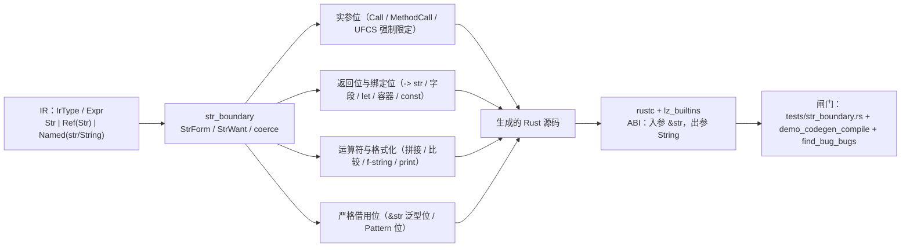

## 需求概述

为 Lang-Zone 编译器治理 `str` / `&str` / `String` 的表示与转换问题。该问题的特征是「设计面广、风险大」：同一语义在多处发射点各自即兴处理，缺少唯一的归一化契约。本轮要求先产出可靠方案、确认后再执行，且**不改变语言语义**。

## 已确认边界（澄清结论）

- 表示层保持现状：`str` 的规范 Rust 表示仍为拥有值 `String`，`&str` 仅作借用视图；不做 `Rc<str>`、不做 str/String 双类型，零语义变更、零规范变更、运行时 ABI 不变。
- 改动面：codegen 与 lz_builtins（可补 Rust 侧适配辅助）；不改 SYNTAX 规范文档、不改 DEMO/lz_std 源码。
- 验收：新增字符串边界专项闸门 + 现有全量闸门零回归。
- 节奏：三阶段独立验收。

## 核心特征

- **契约冻结**：把「值形态」与「目标位置要求」显式建模为受类型约束的枚举与单一转换函数，并以模块级文档记录契约表（同一 LZ 类型的合法 Rust 形态、每种形态在何处允许出现）。
- **单一归一化点**：所有实参位、返回位、绑定位/字段、运算符、格式化插值、严格借用位（泛型/模式位）的字符串形态判定与转换，统一经同一函数产出，不再各自拼接 `&` / `to_string()` / `as_str()`。
- **收敛而非搬家**：分批替换现有散落处理，并删除已被契约层取代的启发式；每阶段给出量化对比（`to_string()` / `as_str()` / `&str` / 扩展 trait / `need_ref` 的出现次数）。
- **零行为变更起步**：第一阶段只新增契约层与单元测试、不触碰任何发射点，用「生成物逐字节一致」证明纯增量；第二阶段按点位分批迁移，每批跑全量闸门；第三阶段新增专项闸门把约 25 类字符串边界（字面量、拥有值、借用视图、`ref str` 形参、字段、容器键、严格借用位、拼接、比较、格式化、迭代、`as str`、常量等）编译并运行校验，锁定契约并清理死启发式。
- **验收结果**：字符串边界专项闸门全绿；现有全量闸门与既有缺陷扫描不新增失败。

## 技术栈与约束

- 语言/工程：Rust 2021 workspace（主 crate `lang-zone`，含 lib + bin；运行时 crate `lz_builtins`）。
- codegen 位置：`src/ir/codegen/mod.rs`（约 900KB，主发射器）、`src/ir/codegen/helpers.rs`、`src/ir/codegen/moddec_emit.rs`；本轮新增子模块 `src/ir/codegen/str_boundary.rs`。
- 运行时 ABI（**冻结，不改**）：`lz_builtins` 字符串入参一律 `&str`，出参 `String`；`StringExt`（`lz_builtins/src/runtime/collections.rs:309`）同时 impl 于 `String` 与 `str`（因此存在 E0034 方法解析歧义，调用点必须强制限定 UFCS）；已有 `&String → &str` 零成本适配先例（`__lz_str_ref`，shims 段；函数名登记于 codegen `LZ_BUILTIN_FN_NAMES` ≈ mod.rs:17046，新增辅助必须同处登记，否则被生成 stub 覆盖）。
- 闸门命令（**必须 `-j 1` 或单目标**，全量并行会因 Windows 页文件不足报 os error 1455 假错）：
- 全量产物编译：`cargo test -j 1 --test demo_codegen_compile -- --include-ignored`
- 缺陷扫描：`cargo test -j 1 --test find_bug_bugs`
- 单文件快回路：`python .fist-wf-20260926/check.py <file.lz> [...]`（转译 + rustc 真编译）
- 快照类：`cargo test -j 1 --test moddec_corpus`、`--test moddec_product_assert`、`--test ir_snapshots`
- 现有散落面（收敛对象，位于 `src/ir/codegen/mod.rs`）：`to_string()` 235 处、`as_str()` 171 处、`&str` 131 处、扩展 trait 强制限定 22 处、`need_ref` 5 处。

## 契约设计（策略核心）

| 来源形态 \ 目标要求 | Owned（拥有值位） | Borrow（可 deref 借用位） | ExactStrRef（严格 &str 位） | Display（插值/格式化） |
| --- | --- | --- | --- | --- |
| Owned（`String`：绑定/字段/调用结果/插值结果） | 原样（多次使用由既有值语义 clone 决策） | `&x`（实参位靠 deref coercion，零成本） | `x.as_str()` | `{}` 用 `x` |
| StrRef（`&str`：`ref str` 形参 / `Ref(Str)` 局部 / 切片结果） | `x.to_string()` | 原样 | 原样 | `{}` 用 `x` |
| StringRef（`&String`：`ref self` 字段访问 / 自动加 `&` 的 String 实参） | `x.clone()` | 原样 | `x.as_str()` | `{}` 用 `x` |
| Static（`&'static str`：字面量与 `const str`） | `"lit".to_string()`（原样 + 拥有化） | 原样 | 原样 | 原样 |


三条铁律（写入新模块的模块级文档）：

1. 值域唯一：LZ `str` ≡ Rust `String`；`&str` 只在「借用视图」与「Rust 侧 ABI」两处出现；`const str` 显式建模为 `Static` 形态（不再作为特例打补丁）。
2. 方向唯一：`&String → &str` 依赖 Rust deref coercion（实参位零成本），`&str → String` 只在 Owned 目标处发生（`to_string()` / `clone()`）；**不允许反向即兴处理**。
3. 职责单一：E0034 的方法解析强制限定（`<StrExt>::lz_*(self, ..)`）不属于边界层职责，保持现状；边界层只决定**实参 / 返回值 / 绑定值的形态**，不改变调用哪个方法。

## 实现要点

### 阶段① 契约冻结 + 边界层骨架（零行为变更）

- 新增 `src/ir/codegen/str_boundary.rs`：契约表文档 + `StrForm` / `StrWant` 枚举 + `form_of_ir(&IrType) -> Option<StrForm>` + `form_of_expr(&Expr) -> StrForm`（字面量→Static、字符串产出方法/插值→Owned、`Ref(Str)` 绑定→StrRef 等）+ `coerce(s: &str, from: StrForm, want: StrWant) -> String`（纯函数，无 `&self`，便于单元测试与复用）。
- 在 `mod.rs` 仅添加 `mod str_boundary;` 与所需 `use`，**不触碰任何发射点** ⇒ 生成物逐字节不变。
- 14~20 格矩阵单测（`#[cfg(test)] mod tests`）覆盖上表全部单元与边界（如 Owned→Owned 不改写、Static→Owned 拥有化、StringRef→ExactStrRef 走 `as_str()`）。
- 验证：`cargo test -j 1 --lib` 单测全绿；全量闸门全绿；str 相关 demo 的生成物哈希与改动前一致。

### 阶段② 分批迁移（每批一个闸门）

- **B1 实参位**：Call / MethodCall 的字符串实参形态（mod.rs 约 10731、11990 簇）、扩展 trait 强制限定处的实参、`need_ref` 的 str 分支（`&` 剥离逻辑）。
- **B2 返回位 / 绑定位**：`-> str`、`__str__`、struct 字段构造、let 绑定、容器元素、`const str`（用 `Static` 形态显式化，替代「const 特例」）。
- **B3 运算符与格式化**：字符串拼接（约 13619 簇）、`==` / `<` 比较（约 13800 簇）、f-string 与 `print` 插值（`gen_fstring` ≈15379 与 `str_typed_vars` ≈3241/7952）。
- **B4 严格借用位与泛型位**：`starts_with / ends_with / contains / find / replace / split / join` 等 `&str` 严格位 → `as_str()`；泛型 `T` 用 `str` 实例化时的克隆/比较/拼接形态。
- 每批流程：先用 [subagent:code-explorer] 穷举该点位的全部发射位置（避免漏改）→ 迁移 → 单文件 `check.py` 快回路 → 全量闸门 → 记录计数对比。**一次一批，批间可独立回滚。**

### 阶段③ 专项闸门 + 清理

- 新增 `tests/str_boundary.rs`：端到端（转译 + rustc 真编译 + 运行比对 stdout），harness 复用 `tests/gen_build_block.rs` 的成熟模式（`env!("CARGO_BIN_EXE_lang-zone")` + `builtins_rlib()` 定位 + 临时目录 + 运行），约 25 类用例：字面量→拥有形参、拥有→`ref str` 形参、`ref str`→拥有形参、str 字段读写、`Dict<str,V>` 键 get/insert、`Set<str>`、`Option<str>`、`Result<str,E>`、`str+str` / `str+int` 拼接、`==` / `<` 比较、`length()`、`s[i]`（含 Unicode 路径）、切片、`for c in s`、f-string 插值、`print`、`__str__` 覆写、`as str`、元组/List 内 str、`ref str` 返回、`const str`、带 str 字段的 struct + `ref self` 方法、`List<str>` 的 sort/unique、接受 str 的闭包、泛型 `T` 用 str 实例化。
- 清理被契约层取代的启发式：`str_typed_vars` 散点判定、`is_str_producing`、`clone()→to_string()` 特例、const 特例、`need_ref` 的 str 分支；保留的启发式必须写清「为何不能由契约层给出」。
- 收口回归：全量闸门 + `find_bug_bugs` + 快照类测试（moddec / ir_snapshots）复核；归档量化数据（各计数前后对比）。

## 架构关系



## 风险与缓解

- **快照类测试**：`DEMO/99_spec/moddec/golden/*.rs` 是入库黄金快照，发射点改动可能触发；每批须跑 moddec / ir_snapshots 相关测试，若确受影响则同批更新并在提交说明中标注。
- **方法解析 E0034**：`StringExt` 同时 impl 于 `String` 与 `str`，强制限定逻辑必须原样保留（边界层不介入方法选择）。
- **f-string 退化**：插值从 `{}` 退化为 `{:?}` 会给字符串加引号；必须由统一 Display 判定接管后再删除 `str_typed_vars` 散点。
- **迁移漏改**：单点语义常有多处发射点，先穷举（[subagent:code-explorer]）再改，杜绝「改一处漏三处」。
- **构建资源**：所有 cargo 测试命令使用 `-j 1` 或单目标，规避 Windows 内存假错。

## 目录结构

```
lang-zone/
├── src/ir/codegen/
│   ├── str_boundary.rs        # [NEW] 字符串边界层：契约文档 + StrForm/StrWant + form_of_ir/form_of_expr + coerce + 矩阵单测。纯函数无状态，供所有发射点复用；不改变当前生成结果。
│   ├── mod.rs                 # [MODIFY] 仅新增 `mod str_boundary;` 与 use（阶段①）；阶段②分批替换发射点：实参位(≈10731/11990)、返回与绑定位、运算符(≈13619/13800)、格式化(gen_fstring≈15379, str_typed_vars≈3241/7952)、const 特例、clone 特例(≈7369/12141)、need_ref str 分支；UFCS 强制限定逻辑保持不动。
│   ├── helpers.rs             # [MODIFY] 可选：把 is_str_named / is_str_producing 等判定委托给边界层（保留函数名与语义，避免外部引用破裂）。
│   └── moddec_emit.rs         # [MODIFY] 仅在 moddec 生成路径涉及 str 形态时同步（预期不改，改则同批更新 golden 说明）。
├── lz_builtins/src/runtime/
│   └── builtins.rs            # [MODIFY] 仅在边界层需要 Rust 侧辅助时补充/对齐 str 适配（与既有 __lz_str_ref 同段）；保持现有公开签名语义不变；新增符号需在 codegen LZ_BUILTIN_FN_NAMES 登记。
├── tests/
│   ├── str_boundary.rs        # [NEW] 字符串边界专项闸门：约 25 类用例，转译 + rustc 真编译 + 运行校验输出；复用 gen_build_block.rs 的二进制/rlib 定位与临时目录模式。
│   └── demo_codegen_compile.rs# [MODIFY] 仅在确有必要时调整 KNOWN_* 基线条目（预期保持不变）。
└── docs/
    └── str-boundary-contract-2026-09-27.md  # [NEW] 设计记录：契约表、形态判定规则、迁移批次与量化对比（非规范文档，不改 SYNTAX）。
```

## 关键接口（仅接口级）

```rust
/// 表达式在 Rust 侧的字符串形态（由 IR 类型 + 表达式种类判定）
pub(super) enum StrForm { Owned, StrRef, StringRef, Static }

/// 目标位置对字符串形态的要求
pub(super) enum StrWant { Owned, Borrow, ExactStrRef, Display }

/// 唯一的形态归一化入口：把 s 由 from 形态转为 want 形态的 Rust 表达式文本
pub(super) fn coerce(s: &str, from: StrForm, want: StrWant) -> String;

/// 从 IR 类型判定字符串形态（非字符串类型返回 None）
pub(super) fn form_of_ir(ty: &crate::ir::types::IrType) -> Option<StrForm>;
```

## Agent Extensions

### SubAgent

- **code-explorer**
- Purpose: 在阶段②每次迁移前，穷举目标点位在 `src/ir/codegen/mod.rs`（约 900KB）与 `helpers.rs` 中的全部发射位置，避免漏改导致「改一处漏三处」的反复回归。
- Expected outcome: 每个批次输出一份带行号与语义分组的候选点清单（例如「实参位：10731 簇、11990 簇、扩展 trait 实参、need_ref str 分支」），迁移后可用同一清单勾选核对，确保零遗漏。

### Skill

- **diagnose**
- Purpose: 当某个迁移批次出现边界类回归（E0308 `&str` vs `String`、E0277 `String: Pattern`、E0599 方法不存在、E0034 多重适用项）时，按「复现 → 最小化 → 假设 → 仪器化 → 修复 → 回归测试」流程定位真实发射路径，而不是靠静态推理猜测。
- Expected outcome: 每个回归都定位到确切的发射点与形态判定缺口，并在边界层补上规则（或写清为何该处必须保留特殊处理），随后由全量闸门确认零新增失败。